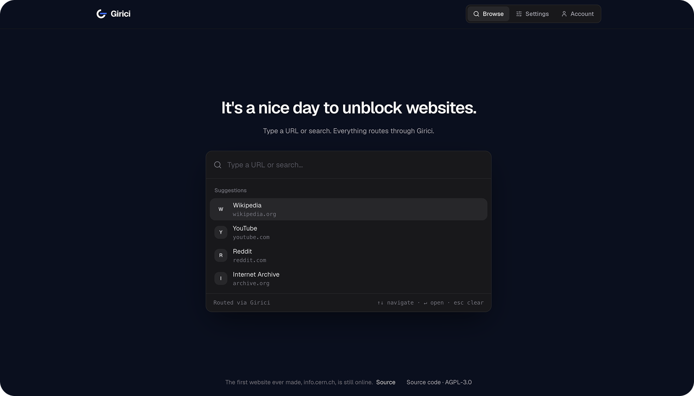

<p align="center">
  <picture>
    <source media="(prefers-color-scheme: dark)" srcset="packages/web/src/assets/brand/girici-icon-dark.svg">
    
  </picture>
</p>
<h1 align="center">Girici</h1>

<p align="center">
🌐 Web proxy project written in Typescript & Vue.js. Node.js alternative for php-proxy.
<br/>
<br/>
 
   
  <a href="https://hub.docker.com/r/halitsever/girici-web-proxy"></a> 
  <a href="https://hub.docker.com/r/halitsever/girici-web-proxy"></a> 
</p>

> **Note:** Girici v1 is no longer maintained. v2, built on its own service worker engine, is the current release.
> `latest` now points to v2; the last v1 image stays available as `halitsever/girici-web-proxy:v1`.

<div align="center">

</div>

- 📝 [**Http/Https Support**](#) - http/https protocols are supported
- 🧑‍💻 [**Can run inside docker**](#) - you can run girici inside of container
- 🎨 [**Fancy UI**](#) - looking good ui for surfing on internet without restriction
- 🎨 [**Use internet of server**](#) - you can install girici on server and you can use server's internet as web proxy


## Documentation

Full docs live in [`docs/`](docs/) (a VitePress site): getting started, how it works, admin and auth,
configuration, and Docker. Run it locally with `npm run docs:dev`.

## Run from source

Requires Node.js 22.19 or newer (24 LTS recommended).

```
npm ci
npm run build
npm start
```

Girici listens on http://localhost:3000.

<div align="center">
<b>Screenshot</b>
<br/>
<br/>

</div>

## Run with Docker

```
docker run -d -p 3000:3000 halitsever/girici-web-proxy:latest
```

`latest` runs v2 (v2.0.0 and newer). The last v1 image stays available as `halitsever/girici-web-proxy:v1`. To
build and run from source instead:

```
docker compose up --build
```

Service workers need HTTPS outside localhost. To get automatic certificates, point a domain at your server, remove
the `ports` mapping of the `girici` service and run:

```
GIRICI_DOMAIN=proxy.example.com docker compose --profile https up -d --build
```

## Configuration

| Variable | Default | Description |
| --- | --- | --- |
| `PORT` | `3000` | Port to listen on. `LISTENER_PORT` is accepted as an alias. |
| `HOST` | `0.0.0.0` | Interface to bind. |
| `LOG_LEVEL` | `info` | `error`, `warn`, `info` or `debug`. |
| `SOURCE_URL` | this repository | Where the UI's source code link points. |
| `GIRICI_DATA_DIR` | `/data` in Docker, `.data` locally | Directory for the SQLite database (`girici.db`). |
| `GIRICI_TRUST_PROXY` | `false` | Trust `X-Forwarded-For`. Behind a proxy, set the hop count (e.g. `1`), not `true`. |
| `GIRICI_SESSION_SECRET` | unset | Overrides the stored session secret; set the same value on every replica. |
| `GIRICI_YT_POTOKEN` | `on` | Mint YouTube GVS poTokens server-side to help video playback. Set `off` to disable. |

## Admin and access

On first run, Girici sends you to a setup screen to create a single admin account, stored in SQLite
(`${GIRICI_DATA_DIR}/girici.db`). After that, the proxy requires a login. Turn on **Public access** in
Settings to let anyone browse without signing in. Forgot the password? Reset it from the command line:

```
node ./reset-admin-password.js
```

See the [documentation](https://halitsever.github.io/girici-web-proxy/guide/admin-and-auth) for details.

## Known limitations

YouTube guards video with its SABR streaming and poToken bot protection. Girici mints a GVS poToken server-side
(`GIRICI_YT_POTOKEN`) and steers the player toward direct streams, which plays many videos, but YouTube still blocks
sustained playback of some, especially from datacenter IPs. A residential egress helps. This stays fragile: a YouTube
change can break it until the token path is updated.


<div align="center">
<a href="https://github.com/halitsever/girici-web-proxy/issues"></a>
</div>

<div align="center">

</div>

## License

Copyright (C) 2021-2026 Halit Sever

Girici is free software: you can redistribute it and/or modify it under the terms of the GNU Affero General Public
License, version 3, as published by the Free Software Foundation. See [LICENSE](LICENSE).

If you run a modified version of Girici as a network service, the AGPL requires you to offer its users the source
code of your version. Set `SOURCE_URL` to point to it; the UI links there.
